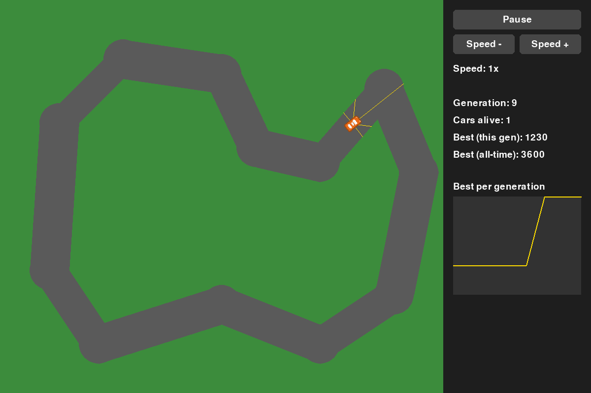

# NEAT Racer

2D cars learn to drive a track, generation by generation, using NEAT (NeuroEvolution of Augmenting Topologies).



## How it works

- 30 cars race at once. Each one is driven by its own small neural network.
- Each car sees the track through 5 radar rays. The ray lengths go into its network.
- The network picks one of 4 actions every frame: steer left, steer right, speed up, slow down.
- A car dies if it leaves the road, or if it barely moves for 3 seconds.
- Fitness is the distance driven. When all cars are dead (or 30 seconds pass), NEAT breeds the next generation from the best drivers.

## Run it

Needs Python 3.

```powershell
python -m venv venv
.\venv\Scripts\Activate.ps1
pip install -r requirements.txt
python main.py
```

Close the window to stop.

## Controls

| Button | What it does |
|--------|--------------|
| Pause / Resume | Freezes or continues the race. |
| Speed - / Speed + | 0.5x, 1x or 2x. |

The side panel also shows the generation, cars alive, best fitness (this generation and all-time), and a graph of the best fitness per generation.

## Built with

- [Pygame Community Edition](https://pyga.me/)
- [NEAT-Python](https://github.com/CodeReclaimers/neat-python)

## Credits

Car image from the [Racing Pack](https://kenney.nl/assets/racing-pack) by Kenney (CC0).
